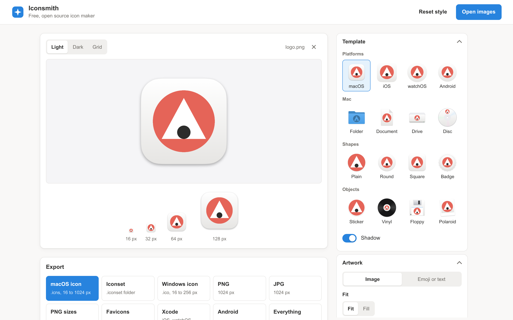

# Iconsmith



A free, open source icon maker. Drop in a picture, emoji or text, pick a template, and export icons for macOS, iOS, watchOS, Android, Windows and the web.

It runs entirely in your browser. There is no server, no account and no upload. It works offline.

## Use it

1. Unzip the folder.
2. Open `index.html` in Safari, Chrome, Edge or Firefox.
3. Drop an image on the preview (or paste one, or choose **Open images**).
4. Pick a template, colours, label and overlay.
5. Choose an export.

Tip: in Safari on macOS Sonoma or later, choose **File → Add to Dock** to use it like an app.

## Templates

All artwork is drawn in code from public platform guidelines. Every template is laid out on a 1024 × 1024 grid.

| Group | Template | Geometry |
| --- | --- | --- |
| Platforms | macOS | 824 × 824 body, 100 px margin, 185.4 px continuous-curvature corners, drop shadow (Big Sur and later grid) |
| | iOS | Full-bleed square with the continuous-corner mask (22.37 % radius). Xcode export is saved unmasked and opaque, because iOS applies the mask |
| | watchOS | Full-bleed circle |
| | Android | 48 dp grid with the 44 dp mask keyline and artwork kept inside the adaptive-icon safe zone. Masks: circle, squircle, rounded square, teardrop |
| Mac | Folder | Folder with any colour. Symbol is embossed (macOS style) or full colour |
| | Document | Page with a folded corner |
| | Drive | External drive, artwork on the front |
| | Disc | Optical disc with label, hub and sheen |
| Shapes | Plain, Round, Square, Badge | Image only, circle, rounded square, scalloped seal |
| Objects | Sticker, Vinyl, Floppy, Polaroid | Outlined cut-out, record label, 3.5-inch disk label, instant photo |

Overlays work on every template: a Finder-style **alias arrow**, or a **corner badge** with any text or emoji.

## Other features

- Emoji or text as the artwork
- Labels in four fonts, plain or pill style
- Brightness, contrast, saturation and hue
- Background removal for flat backgrounds (flood fill from the edges)
- Automatic trimming of empty edges
- Batch export of many images at once
- Settings are remembered between visits

## Exports

| Export | Contents |
| --- | --- |
| macOS icon | `.icns` with 16 to 1024 px (legacy RLE entries for 16 and 32, PNG for the rest) |
| Iconset | `.iconset` folder for `iconutil` |
| Windows icon | `.ico` with 16, 24, 32, 48, 64, 128 and 256 px |
| PNG / JPG | One image at the chosen size, up to 2048 px |
| PNG sizes | 16 to 1024 px |
| Favicons | `favicon.ico`, PNG favicons, Apple touch icons (57 to 180 px), Android Chrome icons, Windows tiles, `site.webmanifest`, `browserconfig.xml` and a `<head>` snippet |
| Xcode | `AppIcon` sets for iOS/iPadOS (all sizes, opaque RGB PNGs), watchOS and macOS, each with `Contents.json` |
| Android | Legacy and round launcher icons for every density, adaptive icon foreground, XML and background colour, 512 px Play Store icon |
| Everything | All of the above in one ZIP |

## Apply icons on a Mac

**Without any tools:** choose **Copy image**, select a file or folder in Finder, press ⌘I, click the small icon at the top of the Info window, then press ⌘V. To restore the original icon, click that icon and press Delete.

**With the helper script** (uses the scripting runtime built into macOS):

```bash
# Apply an icon to one or more files or folders
osascript -l JavaScript mac/iconsmith-apply.js apply MyIcon.icns ~/Projects ~/Invoices

# Restore the default icons
osascript -l JavaScript mac/iconsmith-apply.js clean ~/Projects ~/Invoices
```

## Project layout

```
index.html          App page
styles.css          Styles (light and dark)
src/render.js       Image processing and the template engine
src/exporters.js    Export formats
src/encoders.js     ICNS, ICO, ZIP and RGB PNG writers
src/app.js          Interface
mac/                macOS helper script
```

There are no dependencies and no build step.

## Licence

MIT. See `LICENSE`.

Iconsmith is an independent project. It is not affiliated with Shiny Frog or Image2icon and contains none of their code or artwork.
